# Лабораторная работа 6

Жизненный цикл Архитектурные компоненты

**Выполнил:** Солдатов Владимир Сергеевич  
**Город:** Кемерово  
**Дата:** 6 ноября 2026 года

Отчёт о практической части и контрольных заданиях. Ниже приведены реализация, результаты проверок и настоящие снимки экранов эмулятора.

## Цель и архитектура приложений

Цель работы — исследовать жизненный цикл Activity, перенести состояние и бизнес-логику в ViewModel и организовать однонаправленный поток данных. Выполнены приложение Unscramble и все четыре контрольных задания.

| Модуль | Выполненная работа |
| --- | --- |
| activitylifecycle | Логирование onCreate, onStart, onResume, onPause, onStop, onRestart и onDestroy |
| artspace6 | Единый ArtUiState, ViewModel, MutableStateFlow и публичный StateFlow |
| dessertclicker | ViewModel и класс состояния вместо переменных в Activity |
| unscramble | Игровая логика, состояние, проверки ошибок и границ, измерение покрытия |

### Однонаправленный поток данных

Интерфейс читает неизменяемое состояние и вызывает методы ViewModel в ответ на события пользователя. ViewModel обновляет приватный MutableStateFlow. Подписчик получает новое состояние, и Compose обновляет интерфейс. Изменение данных в одном месте облегчает проверку логики и исключает рассогласование отображаемых значений.

```kotlin
private val _uiState = MutableStateFlow(ArtUiState())
val uiState = _uiState.asStateFlow()
fun next() {
    _uiState.update {
        it.copy(index = (it.index + 1) % artworks.size)
    }
}
```

## Исследование жизненного цикла

В ActivityLifecycle каждый метод жизненного цикла записывает своё название в Logcat с тегом ActivityLifecycle. Дополнительно журнал отображается на экране, чтобы вызовы можно было сопоставить с действиями пользователя.

| Первый экран | Второй экран |
|:---:|:---:|
| 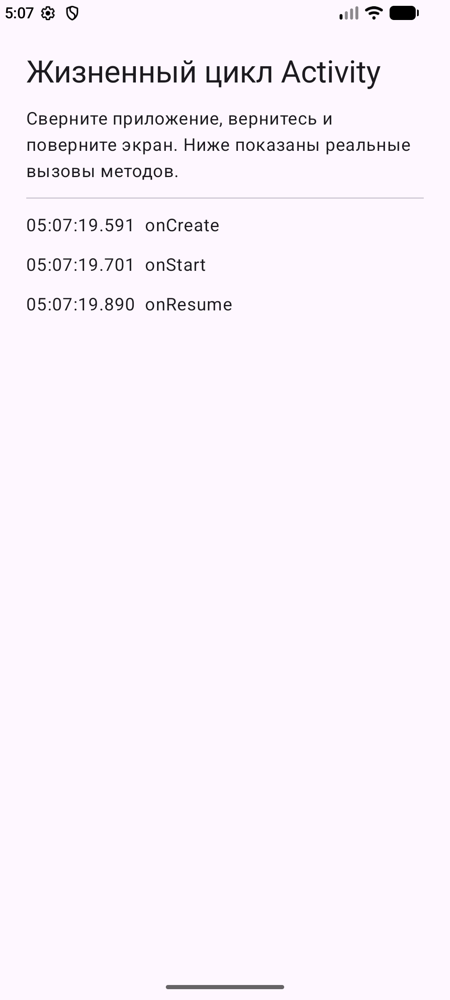 | 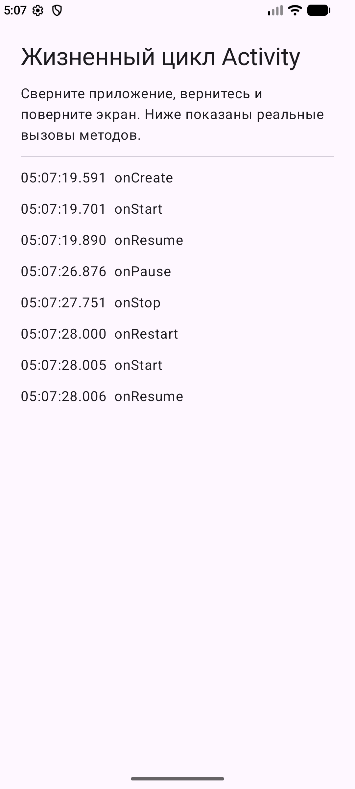 |

*Рисунок 1 — Первоначальный запуск и возврат после сворачивания*

## Последовательности вызовов

| Действие | Наблюдаемая последовательность |
| --- | --- |
| Первый запуск | onCreate → onStart → onResume |
| Переход на домашний экран | onPause → onStop |
| Возврат из фона | onRestart → onStart → onResume |
| Поворот устройства | onPause → onStop → onDestroy → onCreate → onStart → onResume |

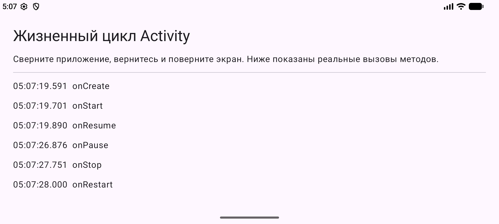

*Рисунок 2 — Журнал после поворота экрана*

При возврате из фона используется прежний экземпляр Activity, поэтому вызывается onRestart. При изменении конфигурации Activity пересоздаётся: прежний экземпляр уничтожается и создаётся новый. Наблюдения подтверждены файлом [docs/lifecycle_logcat.txt](docs/lifecycle_logcat.txt). Вывод относится к выполненному сценарию; при завершении процесса системой вызов onDestroy не гарантируется.

Хранение состояния в обычных полях Activity не защищает от пересоздания. ViewModel переживает изменение конфигурации, но сама по себе не обеспечивает восстановление после завершения процесса. Для такого восстановления дополнительно используют SavedStateHandle или постоянное хранилище.

## ArtSpaceApp с ViewModel

В версии artspace6 создан неизменяемый ArtUiState, содержащий индекс выбранного произведения. ArtViewModel предоставляет публичный StateFlow через asStateFlow и методы next и previous. Экран подписывается через collectAsStateWithLifecycle. Обновление индекса выполняется во ViewModel, а интерфейс только передаёт события.

| Первый экран | Второй экран |
|:---:|:---:|
| 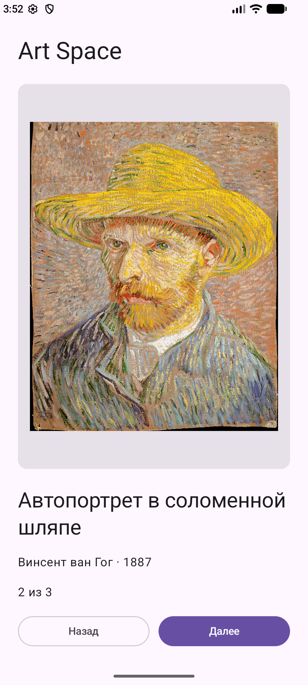 | 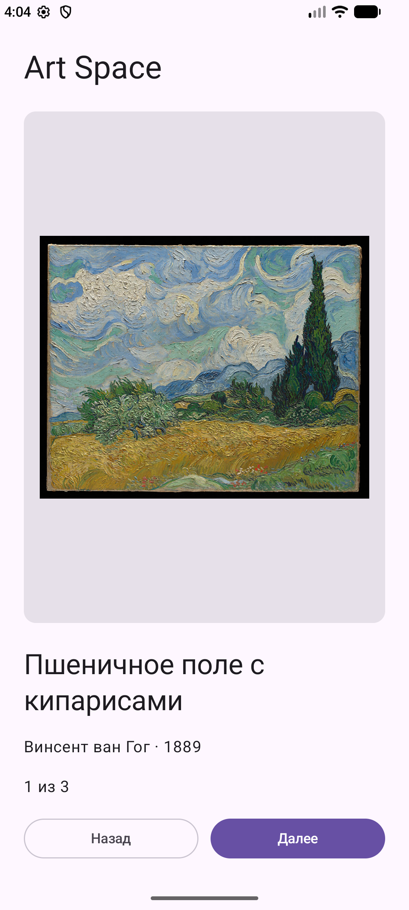 |

*Рисунок 3 — Экран галереи с состоянием из ViewModel*

Автоматизированный тест проверяет циклический переход через границу коллекции. UI-тест выбирает вторую картину, пересоздаёт Activity, проверяет сохранённый индекс и проверяет обратное переключение.

## Сохранение выбранного произведения

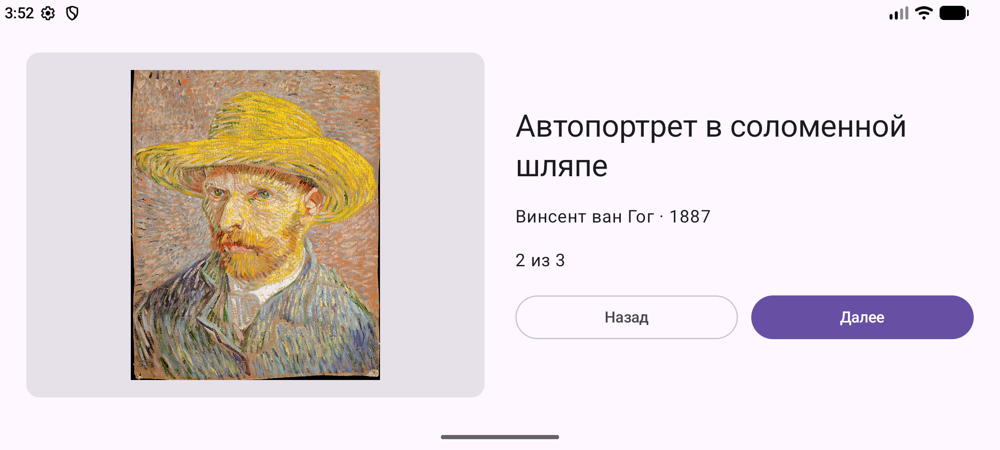

*Рисунок 4 — После поворота сохраняется выбранная картина*

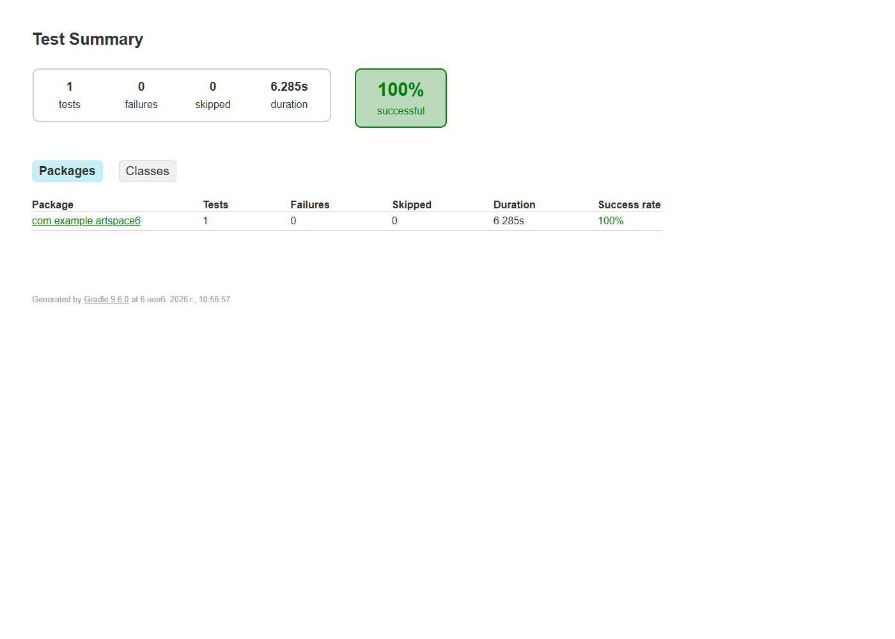

*Рисунок 5 — Проверка пересоздания Activity и переключения изображений*

Результат: 1 модульный тест и 1 инструментальный тест прошли. Поворот устройства также проверен непосредственно на эмуляторе.

## Dessert Clicker с ViewModel

В исходный учебный проект внедрены DessertUiState и DessertViewModel. Состояние включает выручку, число проданных десертов, индекс, изображение и цену текущего десерта. Метод onDessertClicked увеличивает число продаж и выручку; при достижении порога выбирается следующий десерт.

| Первый экран | Второй экран |
|:---:|:---:|
| 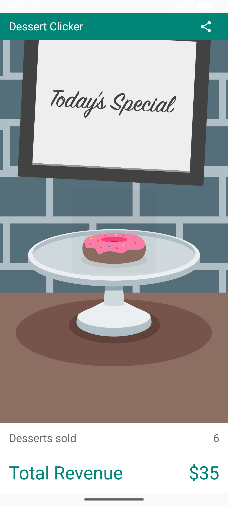 | 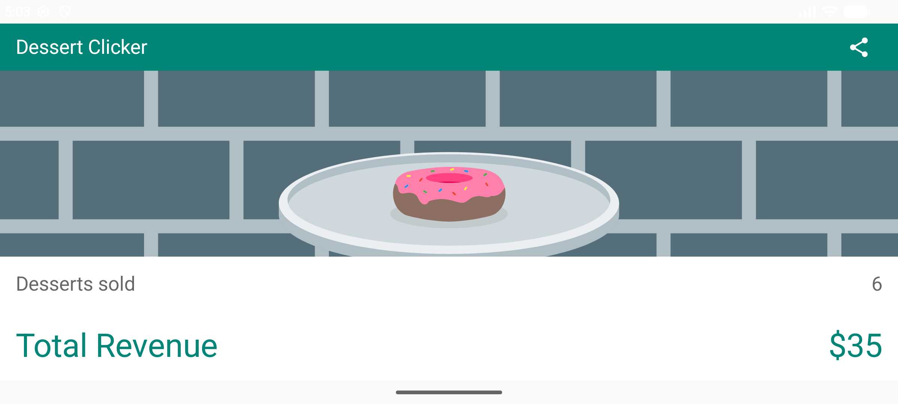 |

*Рисунок 6 — Продажи десертов и сохранение состояния после поворота*

Слой UI подписывается на StateFlow, а обработчик нажатия вызывает метод ViewModel. Вручную проверены повторные нажатия, изменение счётчика и выручки и сохранение значений после поворота. Отправка данных в сторонние приложения не выполнялась.

## Unscramble и обработка ошибки

Игра предлагает разгадать десять слов. За правильный ответ добавляется SCORE_INCREASE. Неверный ответ устанавливает флаг ошибки без изменения счёта и номера слова. Skip переводит к следующему слову без начисления очков. После десятого слова появляется диалог завершения.

| Первый экран | Второй экран |
|:---:|:---:|
| 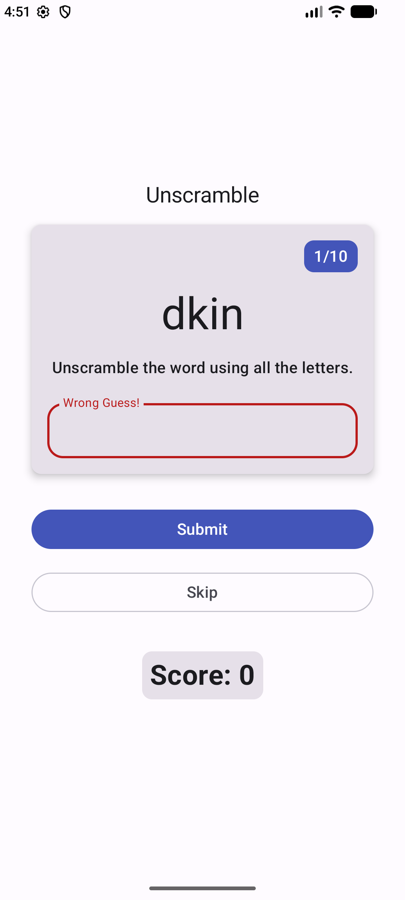 | 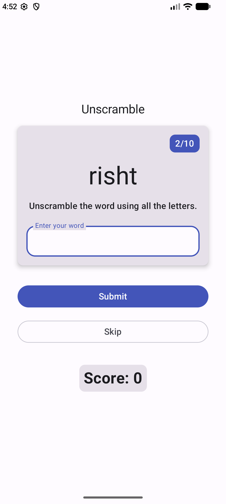 |

*Рисунок 7 — Ошибочный ответ и переход к следующему слову*

Использованные слова исключаются из повторного выбора. Для воспроизводимой проверки повторного выбора во ViewModel добавлен параметр wordPicker с реализацией по умолчанию. В тесте он возвращает заранее заданную последовательность; рабочая версия выбирает слова случайно.

## Завершение и перезапуск игры

| Первый экран | Второй экран |
|:---:|:---:|
| 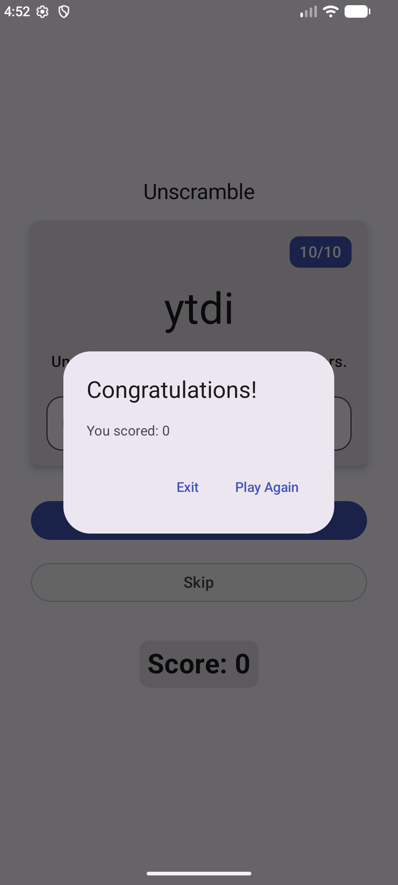 | 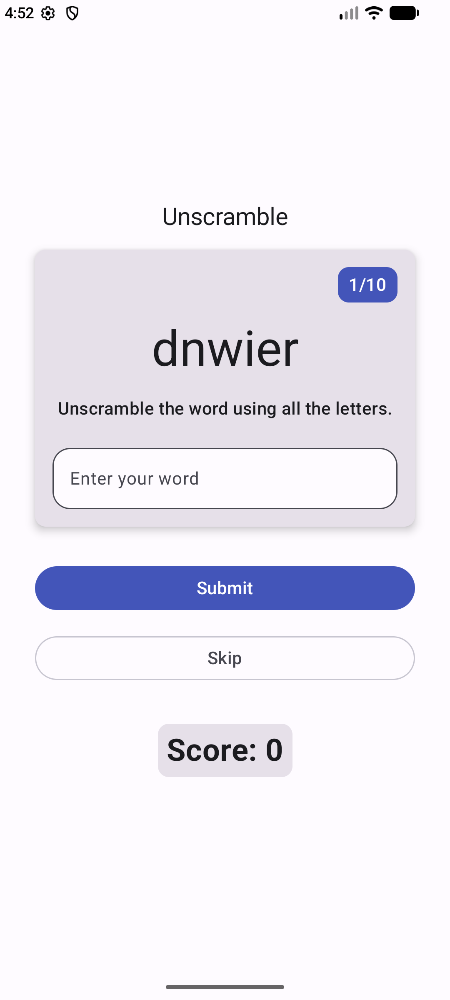 |

*Рисунок 8 — Завершение десяти раундов и новая игра*

На эмуляторе проверены ошибка, пропуск, поворот, завершение после десяти раундов и Play Again. При перезапуске очищаются набор использованных слов и введённый ответ, восстанавливаются начальные счёт и номер слова.

## Модульные тесты Unscramble

| Тест | Проверяемый результат |
| --- | --- |
| IncorrectGuess_ErrorFlagSet | Ошибка установлена, счёт не изменён |
| Initialization_FirstWordLoaded | Первое перемешанное слово загружено |
| AllWordsGuessed_UiStateUpdatedCorrectly | После 10 ответов игра завершена и счёт корректен |
| WordSkipped_ScoreUnchangedAndWordCountIncreased | Пропуск увеличивает номер без изменения счёта |
| CorrectWordGuessed_ScoreUpdatedAndErrorFlagUnset | Правильный ответ увеличивает счёт |
| repeated_word_is_rejected_and_reset_clears_input | Повтор слова отклонён; сброс очищает ввод |

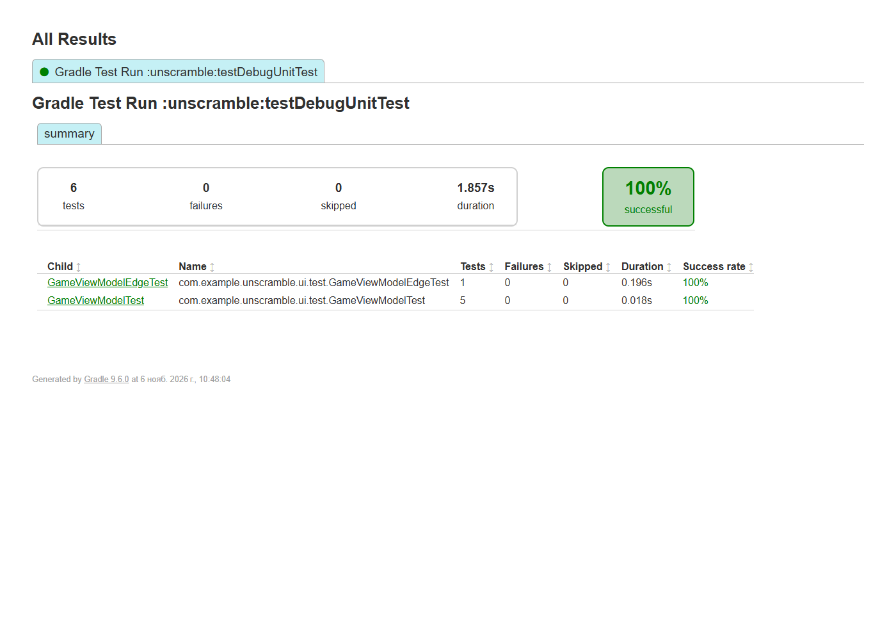

*Рисунок 9 — Все 6 модульных тестов завершились успешно*

## Покрытие GameViewModel

Покрытие измерено JaCoCo 0.8.14 задачей :unscramble:coverageReport после выполнения testDebugUnitTest. Измеряется класс GameViewModel; проценты не распространяются на UI и все классы приложения. Вместо панели IDE сохранены воспроизводимый HTML-отчёт JaCoCo и его реальные снимки по пакету и классу.

| Метрика | Покрыто | Пропущено | Покрытие |
| --- | --- | --- | --- |
| Строки | 49 | 0 | 100% |
| Ветви | 8 | 0 | 100% |
| Инструкции | 253 | 0 | 100% |

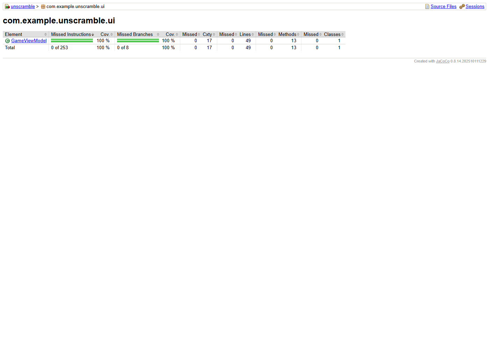

*Рисунок 10 — Пакет com.example.unscramble.ui*

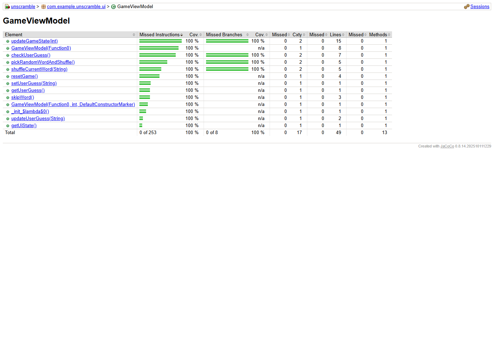

*Рисунок 11 — Покрытие методов GameViewModel*

## Выводы и источники

Исследованы переходы Activity при запуске, сворачивании, возвращении и изменении ориентации. Состояние галереи и счётчика десертов вынесено во ViewModel. Интерфейс получает состояние через StateFlow и передаёт события, соблюдая UDF. Для Unscramble выполнены проверки ошибки, инициализации, границ, правильного ответа, пропуска и сброса. Получено 100% покрытия строк и ветвей GameViewModel.

Методические указания к лабораторной работе 6, предоставленные в файле Laboratornaja+rabota+6.docx.

Жизненный цикл Activity: https://developer.android.com/guide/components/activities/activity-lifecycle

ViewModel: https://developer.android.com/topic/libraries/architecture/viewmodel

Официальные исходники Unscramble: https://github.com/google-developer-training/basic-android-kotlin-compose-training-unscramble

Официальные исходники Dessert Clicker: https://github.com/google-developer-training/basic-android-kotlin-compose-training-dessert-clicker/tree/viewmodel

## Как открыть и запустить

Откройте корневую папку репозитория в Android Studio. После синхронизации выберите один из модулей: `activitylifecycle`, `artspace6`, `dessertclicker`, `unscramble`.

Среда исходной проверки: JBR OpenJDK 25.0.3, Gradle 9.6.0, Android Gradle Plugin 9.4.1, Android SDK 37.0, Android Emulator с API 37. Минимальная версия Android — API 24. Локальный путь к SDK создаётся Android Studio в `local.properties` и не хранится в Git.

```powershell
.\gradlew.bat assembleDebug testDebugUnitTest
.\gradlew.bat :artspace6:connectedDebugAndroidTest
```

### Повторное измерение покрытия

```powershell
.\gradlew.bat :unscramble:coverageReport
```

Готовый отчёт исходного запуска: [покрытие GameViewModel](docs/coverage/html/index.html). Скриншоты отчёта размещены выше. 100% относится к строкам и ветвям GameViewModel, а не ко всему приложению. Измерение выполнено JaCoCo через Gradle.

## Сводка тестов

Модульные тесты: **7**, инструментальные: **1**. Все перечисленные тесты прошли. Результаты: [docs/test-summary.json](docs/test-summary.json).

## Атрибуция

[Источники сведений и изображений](SOURCES.md) · [Учебные проекты и лицензии](THIRD_PARTY_NOTICES.md).
