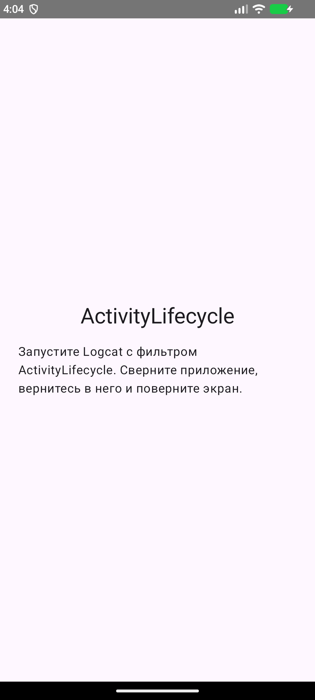
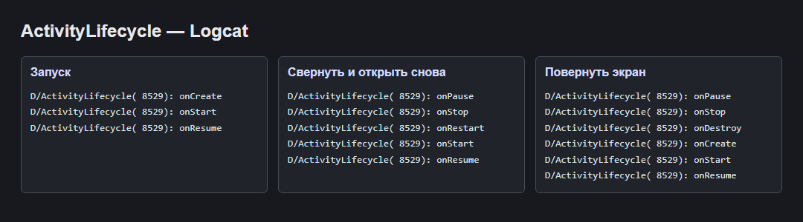
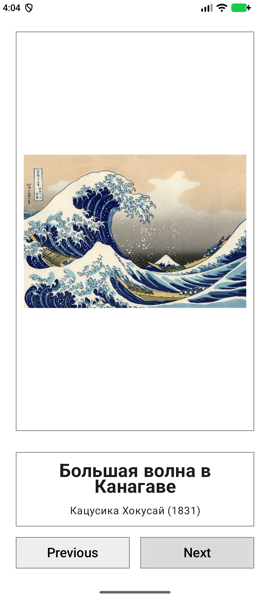
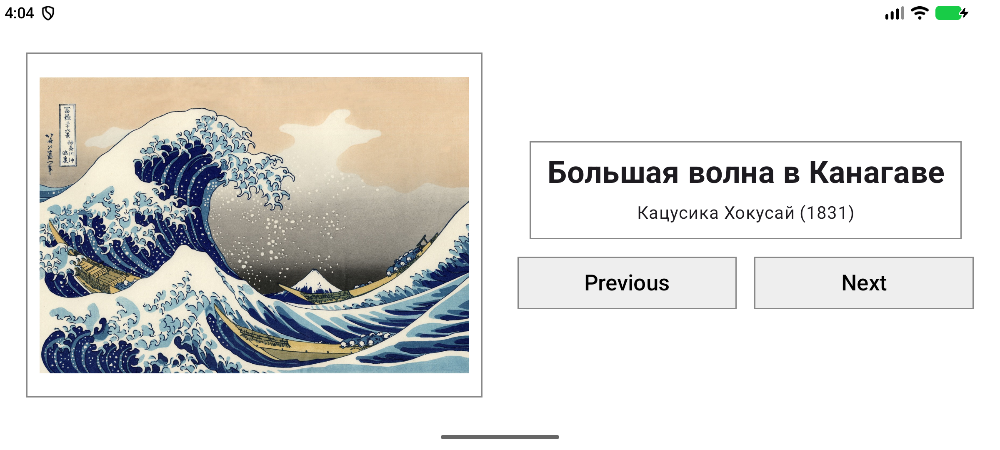
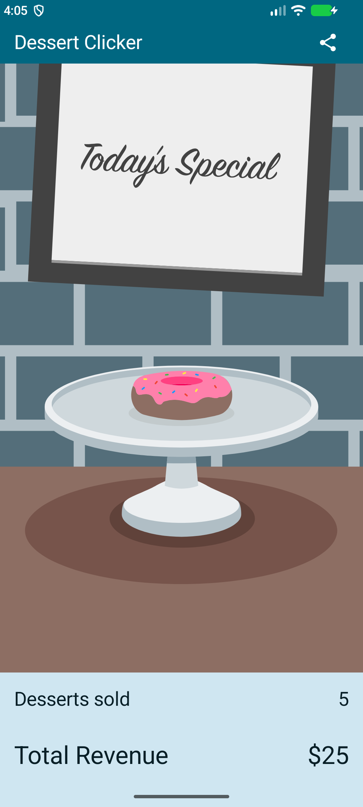
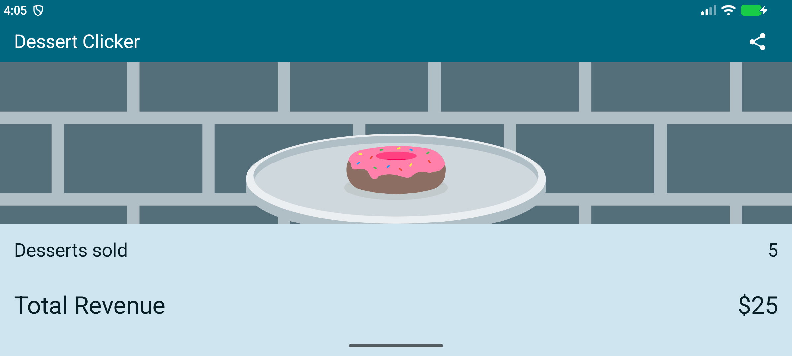
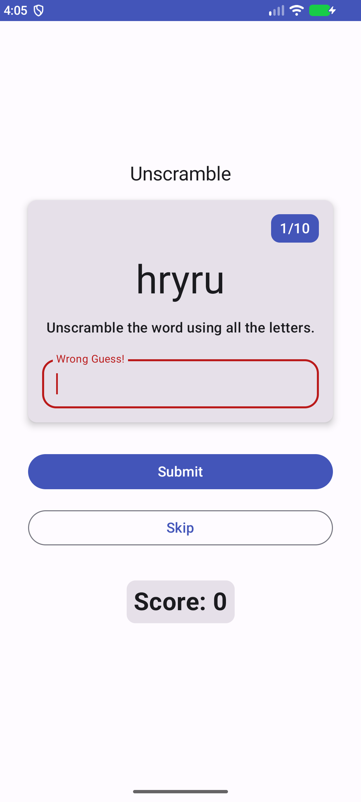
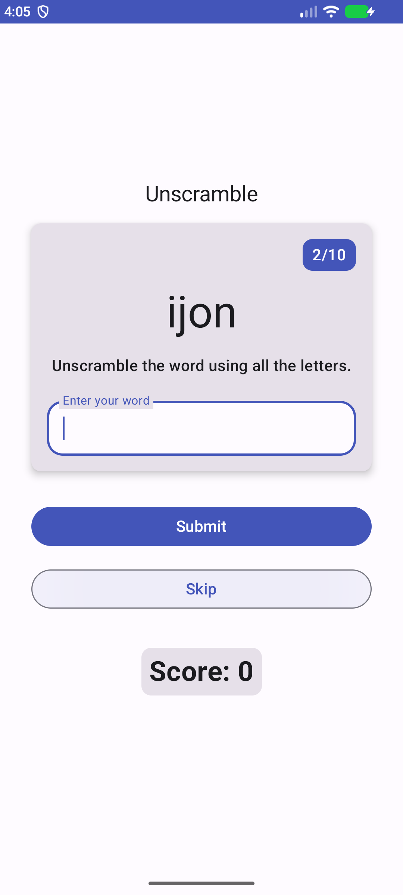
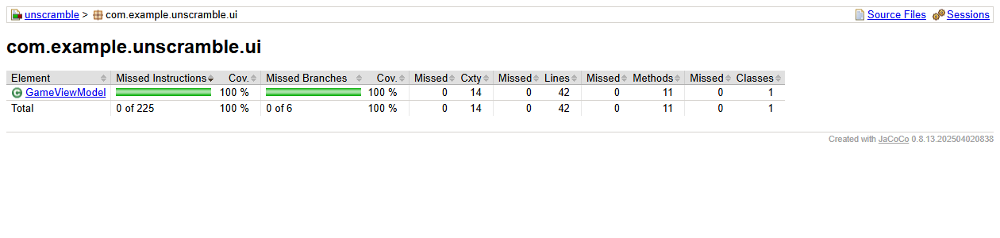

# Лабораторная работа № 6. Жизненный цикл Activity и ViewModel

Солдатов Владимир Сергеевич

## ActivityLifecycle

Каждый метод жизненного цикла пишет своё имя в Logcat с тегом `ActivityLifecycle`. По этим записям можно различить возврат в приложение и создание нового экрана.

| Действие | Что записалось в Logcat |
| --- | --- |
| Запуск приложения | `onCreate → onStart → onResume` |
| Сворачивание через Home | `onPause → onStop` |
| Возврат, если Activity ещё существует | `onRestart → onStart → onResume` |
| Поворот с пересозданием Activity | `onPause → onStop → onDestroy → onCreate → onStart → onResume` |

На эмуляторе запустил приложение, свернул через **Home**, открыл снова и повернул экран. Ниже строки из Logcat в том же порядке.

## ArtSpace и Dessert Clicker

В ArtSpace номер картины хранится в `ArtSpaceUiState`. По нажатию кнопки экран вызывает `next()` или `previous()`, а новый номер получает из `ArtSpaceViewModel`. Благодаря этому выбор картины сохраняется при повороте экрана.

В Dessert Clicker состояние хранит число продаж, выручку, изображение и цену десерта. При нажатии `sellDessert()` прибавляет к выручке цену текущего десерта. Когда число продаж достигает следующего порога, меняется десерт для дальнейших продаж.

В обоих приложениях `ViewModel` меняет приватный `MutableStateFlow`, а экран читает состояние через `StateFlow`. Это однонаправленный поток данных: нажатие идёт в модель, обновлённые данные возвращаются на экран.

После поворота в ArtSpace осталась «Большая волна в Канагаве».

В Dessert Clicker после пяти нажатий на экране было пять продаж и выручка 25 долларов. После поворота оба значения сохранились.

## Unscramble и тесты

Игрок угадывает слово по перемешанным буквам. Верный ответ добавляет очки и открывает следующее слово. При ошибке остаётся то же слово, а при пропуске слово меняется без начисления очков.

| Неверный ответ | Следующее слово после пропуска |
| --- | --- |
|  |  |

В `GameViewModelTest` шесть тестов. Они проверяют первое слово, верный и неверный ответы, пропуск, завершение игры и перезапуск. Вместе с тестами галереи и Dessert Clicker прошли все восемь модульных тестов. Отчёт JaCoCo показал 100 % покрытия `GameViewModel`: 42 из 42 строк и 6 из 6 ветвей.

